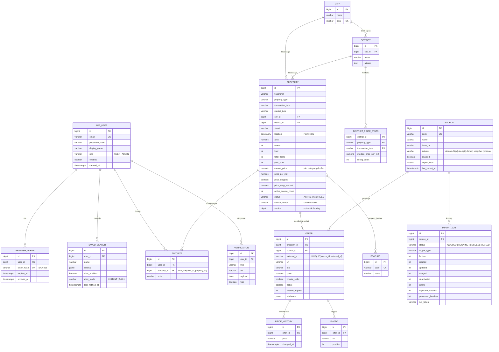
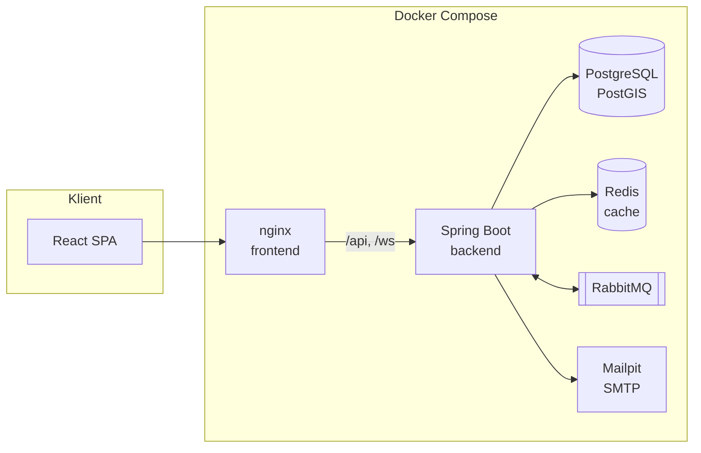
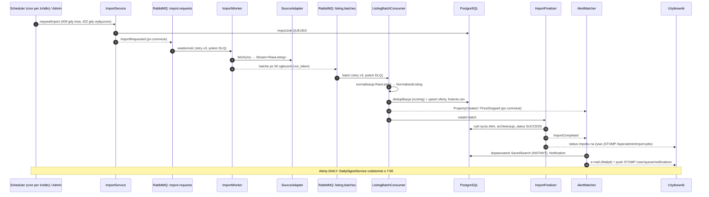

# DomRadar — agregator ogłoszeń nieruchomości

DomRadar to jedna wyszukiwarka ogłoszeń zebranych z wielu portali (Otodom, Morizon, Gratka, OLX,
Nieruchomości-online). To samo mieszkanie wystawione na kilku portalach jest pokazywane jako
**jedna nieruchomość z listą ofert** (portal, cena, link). Główne zalety względem samych portali:

- dużo bardziej zaawansowane wyszukiwanie, filtrowanie i sortowanie (pełnotekstowe po polsku z
  tolerancją literówek, poligon na mapie, sortowanie wielokluczowe, fasety z licznikami),
- historia cen każdej oferty i wykrywanie obniżek,
- porównanie ceny za m² do **mediany dzielnicy**,
- alerty o nowych ogłoszeniach i obniżkach (e-mail, powiadomienie w aplikacji, push przez WebSocket).

Projekt zaliczeniowy z przedmiotu ZTPAI (aplikacja webowa: backend + REST API + frontend + baza danych).

> **Źródła danych:** prawdziwe ogłoszenia z **Otodom** i **OLX** (adaptery live, włączane zmienną
> `LIVE_SOURCES_ENABLED`) oraz — do pracy offline i testów — dane syntetyczne (`DEMO_DATA_ENABLED`).
> Przed włączeniem pobierania z portali przeczytaj [Aspekt prawny źródeł danych](#aspekt-prawny-źródeł-danych).

---

## Spis treści

1. [Użyte technologie](#użyte-technologie)
2. [Uruchomienie](#uruchomienie)
3. [Główne funkcjonalności](#główne-funkcjonalności)
4. [Model danych (ERD)](#model-danych-erd)
5. [Dokumentacja REST API](#dokumentacja-rest-api)
6. [Architektura i przepływ asynchroniczny](#architektura-i-przepływ-asynchroniczny)
7. [Reguły biznesowe](#reguły-biznesowe)
8. [Testy](#testy)
9. [Aspekt prawny źródeł danych](#aspekt-prawny-źródeł-danych)
10. [Decyzje projektowe](#decyzje-projektowe)
11. [Wymagania z regulaminu → realizacja w kodzie](#wymagania-z-regulaminu--realizacja-w-kodzie)

---

## Użyte technologie

| Warstwa | Technologie |
|---|---|
| Backend | Java 21, Spring Boot 3.5 (Web, Validation, Data JPA, Security, AMQP, Cache, Mail, WebSocket/STOMP, Scheduling, Actuator), Hibernate 6 + Hibernate Spatial (JTS), Flyway, MapStruct, Lombok, springdoc-openapi (Swagger UI), JJWT, Jsoup |
| Baza danych | PostgreSQL 16 + PostGIS, `pg_trgm`, `unaccent` (osobny kontener `postgis/postgis:16-3.5`) |
| Kolejka | RabbitMQ 4 (retry + Dead Letter Queue) |
| Cache | Redis 7 |
| Poczta (dev) | Mailpit (podgląd wysłanych e-maili w przeglądarce) |
| Frontend | React 19, TypeScript 7, Vite 8, React Router, TanStack Query, React Hook Form + Zod, Tailwind CSS 4 + shadcn/ui, Leaflet + OpenStreetMap + leaflet.markercluster, Recharts, STOMP.js, sonner |
| Testy | JUnit 5, Mockito, AssertJ, Testcontainers (PostgreSQL/PostGIS, RabbitMQ, Redis), MockMvc, Awaitility; Vitest + Testing Library |
| DevOps | Docker, Docker Compose, nginx, GitHub Actions |

## Uruchomienie

### Wymagania

- Docker Desktop / Docker Engine z Docker Compose v2,
- (opcjonalnie, do pracy bez Dockera) JDK 21+, Node.js 22+.

### Szybki start (Docker Compose)

```bash
git clone <adres-repozytorium> domradar && cd domradar
cp .env.example .env        # na Windows (PowerShell): Copy-Item .env.example .env
# opcjonalnie zmień hasła i JWT_SECRET w pliku .env
docker compose up --build
```

Przy pierwszym starcie (pusta baza) backend automatycznie uruchamia import ze wszystkich włączonych źródeł:

| Tryb (`.env`) | Co się dzieje | Wynik po starcie |
|---|---|---|
| `LIVE_SOURCES_ENABLED=true`, `DEMO_DATA_ENABLED=false` (domyślnie w `.env.example`) | pobranie najnowszych ogłoszeń z Otodom i OLX (6 miast × sprzedaż/wynajem, `LIVE_MAX_PAGES` stron) | po ok. 3 min ~2000 prawdziwych ofert, ~1900 nieruchomości |
| `LIVE_SOURCES_ENABLED=false`, `DEMO_DATA_ENABLED=true` | dane syntetyczne, działa bez internetu | po ok. 1 min ~1250 nieruchomości z ~2500 ofert |

Ogłoszenia są zapisywane w bazie PostgreSQL (wolumen `pgdata`) — wejście na stronę nie łączy się z portalami,
wyszukiwarka czyta wyłącznie z bazy. Kolejne importy uruchamia scheduler **raz dziennie** (Otodom 4:00, OLX 4:30;
pominięty import jest nadrabiany po starcie aplikacji) lub admin przyciskiem „Importuj”. Godzinę można zmienić
w panelu admina (harmonogram cron źródła). Uwaga: `docker compose down -v` usuwa wolumen z bazą — wtedy
przy następnym starcie dane zostaną pobrane od nowa.

| Adres | Co |
|---|---|
| http://localhost:3080 | aplikacja (frontend; nginx proxuje `/api` i `/ws` do backendu) |
| http://localhost:3080/swagger-ui.html | Swagger UI (również http://localhost:8080/swagger-ui.html) |
| http://localhost:8025 | Mailpit — skrzynka z e-mailami alertów |
| http://localhost:15672 | panel RabbitMQ (login/hasło z `.env`: `RABBITMQ_USER` / `RABBITMQ_PASSWORD`) |

Porty na hoście można zmienić w `.env` (`FRONTEND_PORT`, `BACKEND_PORT`, `POSTGRES_PORT` itd.).
PostgreSQL jest domyślnie wystawiony na porcie **55432**, żeby nie kolidować z lokalnie zainstalowanym PostgreSQL.

### Konta demo

Konta są tworzone przy starcie na podstawie zmiennych środowiskowych (nie ma ich w kodzie ani w migracjach):

| Rola | E-mail | Hasło |
|---|---|---|
| ADMIN | wartość `ADMIN_EMAIL` (domyślnie w `.env.example`: `admin@domradar.local`) | wartość `ADMIN_PASSWORD` |
| USER | wartość `DEMO_USER_EMAIL` (domyślnie `user@domradar.local`) | wartość `DEMO_USER_PASSWORD` |

Można też założyć własne konto przez formularz rejestracji.

### Scenariusz demonstracyjny

1. Wyszukiwarka: wpisz `balkon -parter`, zaznacz Warszawę i 2–3 pokoje, posortuj po cenie za m² rosnąco
   i dodaj drugi klucz „Metraż malejąco”. Skopiuj adres URL — link odtwarza identyczne wyszukiwanie.
2. Na mapie użyj „Rysuj obszar” (kliknięcia = wierzchołki, „Zakończ”) albo „Szukaj w tym obszarze”.
3. Otwórz nieruchomość z oznaczeniem „2 portale” — zobaczysz oferty z obu portali, wykres historii cen i
   porównanie do mediany dzielnicy.
4. Zaloguj się jako użytkownik, zapisz wyszukiwanie z alertem **INSTANT**.
5. Zaloguj się jako admin (np. w drugiej przeglądarce), w „Panel admina → Źródła” kliknij „Importuj” przy Otodom lub OLX.
   W zakładce „Importy” postęp aktualizuje się na żywo. Nowe ogłoszenia pasujące do wyszukiwania z alertem
   dają użytkownikowi toast + powiadomienie w dzwonku, a e-mail trafia do Mailpit. (W trybie demo kolejne importy
   symulują też zmiany cen i znikające ogłoszenia.)
6. W „Panel admina → Nieruchomości” edytuj nieruchomość. Gdy ktoś inny zapisze ją w międzyczasie, pojawi się
   dialog konfliktu wersji (409) z opcją wczytania aktualnych danych.

### Praca lokalna bez kontenerów aplikacji

```bash
docker compose up -d postgres rabbitmq redis mailpit   # sama infrastruktura
cd backend && ./mvnw spring-boot:run                    # profil dev czyta ../.env, port 8080
cd frontend && npm install && npm run dev               # http://localhost:5173 (proxy /api i /ws na :8080)
```

Testy: `cd backend && ./mvnw verify` (wymaga Dockera — Testcontainers) oraz `cd frontend && npm test`.

### Konfiguracja

- `backend/src/main/resources/application.yml` + profile `application-dev.yml`, `application-prod.yml`
  (kontener), `application-test.yml` (testy).
- **Sekrety wyłącznie ze zmiennych środowiskowych** (`POSTGRES_PASSWORD`, `RABBITMQ_PASSWORD`, `JWT_SECRET`,
  `ADMIN_PASSWORD`, ...). Do repozytorium trafia tylko `.env.example`; `.env` jest w `.gitignore`.
  Brak `JWT_SECRET` (lub krótszy niż 32 znaki) zatrzymuje start aplikacji.

## Główne funkcjonalności

**Wyszukiwarka (publiczna)**
- pełnotekstowe wyszukiwanie po polsku (tsvector + `unaccent`, dopasowanie prefiksowe zamiast stemmera),
  tolerancja literówek (`pg_trgm`, np. `mkotow` → Mokotów), wykluczanie słów (`-parter -suterena`), filtr ulicy,
- filtry: transakcja, typ, rynek, miasta i dzielnice (wielokrotny wybór), cena, cena/m², metraż, pokoje (1…5+),
  piętro od–do, „nie parter”, „nie ostatnie piętro”, liczba pięter, rok budowy, cechy (tryb ALL/ANY),
  portale (include/exclude), tylko prywatne / tylko biura, obszar mapy (bbox), promień od punktu,
  poligon GeoJSON, dodane w ostatnich N dniach, obniżka w ostatnich N dniach, minimalny % obniżki,
  dni na rynku, tylko nieruchomości z ≥ 2 portali, archiwalne,
- sortowanie wielokluczowe: trafność, cena, cena/m², metraż, data dodania, data zmiany ceny, % obniżki,
  dni na rynku, odległość od punktu, % względem mediany dzielnicy,
- fasety z liczebnościami (dzielnice, pokoje, typy, portale) i histogram cen,
- paginacja `page`/`size` (max 100) z `totalElements` i `totalPages`,
- przy każdym wyniku: „X% poniżej/powyżej mediany dzielnicy”,
- widok listy, mapy (klastrowanie) i podzielony; stan filtrów w URL (link do udostępnienia),
- szczegóły: galeria, wszystkie oferty z portali, wykres historii cen, mediana dzielnicy, mini mapa,
- porównywarka do 4 nieruchomości.

**Użytkownik (USER)**: zapisane wyszukiwania (CRUD, edycja kryteriów, alerty INSTANT/DAILY), ulubione z notatkami
(oznaczenie archiwalnych), powiadomienia na żywo (toast + dzwonek), dzienny digest e-mail.

**Administrator (ADMIN)**: CRUD źródeł z harmonogramem cron, uruchamianie importu (202), lista zadań importu
z filtrami i statusem na żywo, edycja nieruchomości z optimistic locking, ręczne scalanie i rozdzielanie
duplikatów, CRUD ofert (ręczne dodanie przez pipeline deduplikacji), zarządzanie rolami i blokadą kont.

## Model danych (ERD)



Schemat, rozszerzenia, indeksy i słowniki tworzą migracje Flyway w `backend/src/main/resources/db/migration`
(`V1`–`V9`). Najważniejsze indeksy: GIN na `search_vector` i trigramach `search_text`/ulicy, GiST na
`location`, złożone btree pod filtry i sortowania oraz częściowy unikalny indeks
`ux_import_job_one_active` (co najwyżej jeden aktywny import na źródło).

## Dokumentacja REST API

Pełna, interaktywna dokumentacja z opisami, przykładami i schematem bezpieczeństwa JWT:
**http://localhost:3080/swagger-ui.html** (specyfikacja OpenAPI: `/v3/api-docs`).
Aby wywołać chronione endpointy w Swagger UI: `POST /api/v1/auth/login` → skopiuj `accessToken` → *Authorize*.

Wszystkie błędy mają format **RFC 7807** (`application/problem+json`), np.:

```json
{
  "type": "https://domradar.local/problems/saved-search-limit",
  "title": "Naruszenie reguły biznesowej",
  "status": 422,
  "detail": "Osiągnięto limit 10 zapisanych wyszukiwań",
  "errorCode": "SAVED_SEARCH_LIMIT",
  "timestamp": "2026-11-19T21:11:27Z",
  "details": { "limit": 10 }
}
```

Błędy walidacji (400) zawierają dodatkowo `fieldErrors: [{ "field": "email", "message": "..." }]`.

Prefiks wszystkich ścieżek: `/api/v1`. Role: **public** — bez logowania, **USER** — dowolny zalogowany, **ADMIN** — administrator.

| Metoda | Ścieżka | Rola | Opis | Kody |
|---|---|---|---|---|
| POST | `/auth/register` | public | rejestracja (auto-login) | 201 + Location, 400, 409 |
| POST | `/auth/login` | public | logowanie, refresh token w ciasteczku httpOnly | 200, 400, 401, 403 |
| POST | `/auth/refresh` | public (ciasteczko) | nowy access token, rotacja refresh tokenu | 200, 401 |
| POST | `/auth/logout` | public (ciasteczko) | unieważnienie refresh tokenu | 204 |
| GET | `/auth/me` | USER | dane zalogowanego | 200, 401 |
| POST | `/properties/search` | public | wyszukiwanie (kryteria w body, `page`, `size`, `sort`, `facets`) | 200, 400 |
| GET | `/properties/search` | public | to samo przez parametry URL (linki) | 200, 400 |
| POST | `/properties/search/map` | public | punkty na mapę (max 3000) | 200, 400 |
| GET | `/properties/{id}` | public | szczegóły: oferty, historia cen, zdjęcia, mediana | 200, 404 |
| GET | `/properties/compare?ids=` | public | porównanie 1–4 nieruchomości | 200, 400 |
| GET | `/dictionaries/cities`, `/districts`, `/features`, `/sources` | public | słowniki | 200 |
| GET | `/stats/districts` | public | mediana i średnia ceny za m² per dzielnica (cache) | 200 |
| GET | `/me/saved-searches` | USER | lista zapisanych wyszukiwań | 200 |
| GET | `/me/saved-searches/{id}` | USER | szczegóły | 200, 404 |
| POST | `/me/saved-searches` | USER | zapis (limity 10 / 3 INSTANT) | 201 + Location, 400, 422 |
| PUT | `/me/saved-searches/{id}` | USER | pełna aktualizacja | 200, 400, 404, 422 |
| PATCH | `/me/saved-searches/{id}` | USER | nazwa / alert | 200, 404, 422 |
| DELETE | `/me/saved-searches/{id}` | USER | usunięcie | 204, 404 |
| GET | `/me/favorites` | USER | ulubione (paginacja) | 200 |
| POST | `/me/favorites` | USER | dodanie | 201 + Location, 404, 409 |
| PATCH | `/me/favorites/{id}` | USER | notatka (dodanie/edycja/usunięcie) | 200, 404 |
| DELETE | `/me/favorites/{id}` | USER | usunięcie | 204, 404 |
| GET | `/me/notifications` | USER | powiadomienia (paginacja, `unreadOnly`) | 200 |
| GET | `/me/notifications/unread-count` | USER | licznik dzwonka | 200 |
| PATCH | `/me/notifications/{id}` | USER | przeczytane / nieprzeczytane | 200, 404 |
| PATCH | `/me/notifications` | USER | oznacz wszystkie | 200 |
| GET | `/admin/sources`, `/admin/sources/{id}` | ADMIN | źródła | 200, 404 |
| POST | `/admin/sources` | ADMIN | dodanie źródła | 201 + Location, 400, 409, 422 |
| PUT | `/admin/sources/{id}` | ADMIN | edycja (włączenie, cron, adapter) | 200, 400, 404, 409, 422 |
| DELETE | `/admin/sources/{id}` | ADMIN | usunięcie (tylko bez ofert) | 204, 404, 409 |
| GET | `/admin/adapters` | ADMIN | zarejestrowane adaptery | 200 |
| POST | `/admin/sources/{id}/imports` | ADMIN | uruchomienie importu przez RabbitMQ | **202** + Location, 404, 409, 422 |
| GET | `/admin/import-jobs` | ADMIN | zadania importu (paginacja + filtry `sourceId`, `status`, `from`, `to`) | 200 |
| GET | `/admin/import-jobs/{id}` | ADMIN | szczegóły zadania | 200, 404 |
| GET | `/admin/properties`, `/admin/properties/{id}` | ADMIN | lista / szczegóły z wersją | 200, 404 |
| POST | `/admin/properties` | ADMIN | nowa nieruchomość z ofertą początkową | 201 + Location, 400, 422 |
| PUT | `/admin/properties/{id}` | ADMIN | edycja z optimistic locking | 200, 400, 404, **409**, 422 |
| DELETE | `/admin/properties/{id}` | ADMIN | usunięcie z ofertami | 204, 404 |
| POST | `/admin/properties/{id}/merge` | ADMIN | scalenie duplikatu | 200, 404, 409, 422 |
| POST | `/admin/properties/{id}/split` | ADMIN | rozdzielenie ofert | 201 + Location, 404, 409, 422 |
| GET | `/admin/offers`, `/admin/offers/{id}` | ADMIN | oferty (paginacja + filtry) | 200, 404 |
| POST | `/admin/offers` | ADMIN | ręczne dodanie oferty (deduplikacja) | 201 + Location, 400, 404, 409 |
| PUT | `/admin/offers/{id}` | ADMIN | edycja (zmiana ceny → historia) | 200, 400, 404 |
| DELETE | `/admin/offers/{id}` | ADMIN | usunięcie | 204, 404 |
| GET | `/admin/users`, `/admin/users/{id}` | ADMIN | użytkownicy (wyszukiwanie, paginacja) | 200, 404 |
| PATCH | `/admin/users/{id}` | ADMIN | rola / blokada | 200, 404, **409** |
| DELETE | `/admin/users/{id}` | ADMIN | usunięcie konta | 204, 404, 409 |
| POST | `/admin/alerts/daily-digest` | ADMIN | ręczne uruchomienie dziennego digestu | 200 |

Niezalogowany → **401**, zalogowany bez roli ADMIN na `/admin/**` → **403** (oba jako ProblemDetail).

**WebSocket (STOMP)**: endpoint `/ws`, token w nagłówku `Authorization: Bearer …` ramki CONNECT.
Kanały: `/user/queue/notifications` (powiadomienia o alertach), `/topic/admin/import-jobs` (status importów, tylko ADMIN).

## Architektura i przepływ asynchroniczny

Backend jest podzielony na moduły (pakiety) `auth`, `user`, `source`, `ingestion`, `property`, `search`,
`savedsearch`, `favorite`, `notification`, `common`. W każdym obowiązują warstwy
**controller** (tylko HTTP, DTO jako rekordy) → **service** (logika biznesowa, bez klas HTTP; błędy jako
`DomainException` z `ErrorCode`) → **repository** (Spring Data JPA, natywny SQL dla wyszukiwarki).
Encje nie wychodzą poza serwisy — mapowanie MapStruct lub jawne konstruktory DTO.



Przepływ importu i alertów:



Po zakończonym imporcie odświeżane są mediany dzielnic (`district_price_stats`) i unieważniany jest cache Redis.

## Reguły biznesowe

| # | Reguła | Implementacja | Testy |
|---|---|---|---|
| 1 | Deduplikacja: nowa oferta trafia do istniejącej nieruchomości, gdy scoring ≥ 70/100 (miasto/typ/transakcja równe; dzielnica, metraż ±2%, pokoje, piętro, odległość < 150 m, cena ±7%, trigramy tytułu). Admin może scalić/rozdzielić ręcznie. | `ingestion/dedup/DedupScorer`, `DeduplicationService`, `PropertyCandidateRepository`; `property/admin/PropertyAdminService#merge/split` | `DedupScorerTest`, `TrigramSimilarityTest`, `ImportIT`, `AdminIT` |
| 2 | Historia cen tylko przy realnej zmianie; `priceDropped` = spadek ≥ 3% w 30 dniach; `currentPrice` = najniższa cena aktywnej oferty. | `property/pricing/PriceAnalyzer`, `PropertyRecalculator`, `ListingUpsertService#applyUpdate` | `PriceAnalyzerTest`, `ImportIT` |
| 3 | Oferta niewidziana w 3 kolejnych udanych importach → nieaktywna; nieruchomość bez aktywnych ofert → ARCHIVED (znika z wyszukiwania, zostaje w ulubionych z oznaczeniem). | `property/lifecycle/OfferLifecyclePolicy`, `ingestion/ImportFinalizer`, `PropertyRecalculator` | `OfferLifecyclePolicyTest`, `ImportIT` |
| 4 | Nie można uruchomić importu źródła z jobem QUEUED/RUNNING → 409; wyłączonego źródła → 422. | `ingestion/ImportService#requestImport` (+ blokada wiersza i częściowy unikalny indeks) | `ImportServiceTest`, `ImportIT` |
| 5 | USER: max 10 zapisanych wyszukiwań, w tym max 3 z alertem INSTANT → 422. | `savedsearch/SavedSearchLimitPolicy`, `SavedSearchService` | `SavedSearchServiceTest`, `UserFeaturesIT` |
| 6 | Admin nie może zdegradować/zablokować/usunąć siebie ani ostatniego aktywnego admina → 409. | `user/AdminProtectionPolicy`, `UserAdminService` | `AdminProtectionPolicyTest`, `AdminIT` |
| 7 | Edycja nieruchomości z optimistic locking → 409 przy konflikcie wersji. | `property/admin/PropertyAdminService#checkVersion` + `@Version` w `Property` | `PropertyVersionCheckTest`, `AdminIT` |
| 8 | Walidacja kryteriów: min ≤ max, poligon poprawny i ≤ 100 punktów, promień ≤ 50 km. | `search/validation/SearchCriteriaValidator` (`@ValidSearchCriteria`) | `SearchCriteriaValidatorTest`, `SearchIT` |

## Testy

- **Backend: 125 testów** (`./mvnw verify`):
  - 19 klas testów jednostkowych (JUnit 5, Mockito, AssertJ): harmonogram importów, parsowanie odpowiedzi Otodom i OLX
    (syntetyczne fikstury), redakcja danych kontaktowych, scoring deduplikacji, trigramy,
    parsery wartości, historia cen i `priceDropped`, cykl życia ofert, blokada równoległego importu,
    limity zapisanych wyszukiwań, ochrona ostatniego admina, optimistic locking, walidator kryteriów,
    sortowanie, builder SQL, dopasowanie alertów, robots.txt, parser snapshotów, JWT;
  - 7 klas testów integracyjnych (Testcontainers: PostGIS, RabbitMQ, Redis + MockMvc): schemat i migracje,
    rejestracja/logowanie/refresh, pełny import DemoAdapter → RabbitMQ → deduplikacja, 409/422 importu,
    403 dla USER na endpointach admina, wyszukiwanie z filtrami/sortowaniem/paginacją/fasetami,
    cache faset w Redisie, limity wyszukiwań (422), CRUD ulubionych, alerty i powiadomienia, panel admina.
- **Frontend: 16 testów Vitest**: serializacja filtrów do URL (round-trip), formatowanie, porównywarka,
  mapowanie błędów ProblemDetail na formularz, formularz rejestracji (walidacja Zod i błąd 409 z API).

## Aspekt prawny źródeł danych

**Stan techniczny.** Pobieranie prawdziwych ogłoszeń jest zrobione możliwie „grzecznie”:

- adaptery `OtodomHttpAdapter` (osadzony JSON ze stron wyników) i `OlxApiAdapter` (endpoint
  `/api/v1/offers/`, wprost dozwolony w robots.txt OLX) pobierają **wyłącznie strony wyników wyszukiwania**;
- każde żądanie jest sprawdzane z `robots.txt` portalu (parser zgodny z RFC 9309: wzorce `*` i `$`,
  ścieżka razem z query stringiem); brak zgody = brak żądania;
- min. 3 s odstępu między żądaniami, identyfikujący `User-Agent` (`LIVE_USER_AGENT` — warto dopisać kontakt),
  domyślnie tylko 2 strony na miasto i rodzaj transakcji (~50 żądań na import), import raz dziennie w nocy;
- **bez logowania i bez obchodzenia zabezpieczeń**: odpowiedź HTTP 403/429 kończy pobieranie (bez ponowień);
- **minimalizacja danych osobowych (RODO)**: nie pobieramy stron kontaktowych ani numerów telefonów,
  nie zapisujemy imion osób prywatnych (tylko „osoba prywatna” albo nazwa firmy), a z opisów usuwamy numery
  telefonów i adresy e-mail (`ContactRedactor`); zdjęcia nie są kopiowane — wyświetlamy je z CDN portalu;
- każda oferta linkuje do oryginalnego ogłoszenia („Przejdź”), gdzie odbywa się kontakt.

**Ryzyko prawne (do świadomej decyzji właściciela projektu).** Zgodność z robots.txt **nie oznacza zgody**
właściciela serwisu. Regulaminy Otodom i OLX zabraniają automatycznego pobierania treści, a zbiory ogłoszeń mogą
być chronione jako baza danych (prawo *sui generis*, ustawa o ochronie baz danych / dyrektywa 96/9/WE).
Projekt ma charakter edukacyjny, niekomercyjny i pobiera niewielkie ilości danych, ale **nie jest to podstawa
prawna**. Bezpieczne warianty: uzyskać zgodę portalu lub dostęp do oficjalnego API/feedu, ograniczyć się do
prezentacji na zaliczeniu albo przełączyć aplikację w tryb demo (`LIVE_SOURCES_ENABLED=false`,
`DEMO_DATA_ENABLED=true`) — wtedy działają dane syntetyczne:

1. **`DemoAdapter`** — deterministycznie generuje realistyczne ogłoszenia dla kilku „portali” (duplikaty między
   portalami, zmiany cen, znikające ogłoszenia; fikcyjne nazwy biur, linki `/demo/...`);
2. **`SnapshotAdapter`** — parsuje ręcznie przygotowane pliki JSON/HTML z `data/snapshots/<kod-źródła>/`.

Kafelki mapy pochodzą z OpenStreetMap (zgodnie z polityką użytkowania kafelków OSM do celów demonstracyjnych).

## Decyzje projektowe

- **Spring Boot 3.5 zamiast 4.x** — zgodnie z wymaganiami projektu (stack „Spring Boot 3.x”); użyto
  najnowszej wersji 3.5.x. Kompilacja z `--release 21`.
- **Natywny SQL w wyszukiwarce** (`SearchSqlBuilder` + `NamedParameterJdbcTemplate`) zamiast JPA Criteria —
  pełnotekstowe zapytania, trigramy, PostGIS, fasety i percentyle są w SQL czytelniejsze i szybsze.
  Wszystkie wartości są parametrami nazwanymi, a nazwy kolumn sortowania pochodzą z białej listy (`SortField`),
  więc nie ma ryzyka SQL injection.
- **Polski full-text bez stemmera**: PostgreSQL nie ma polskiego słownika, więc konfiguracja `domradar_pl`
  to `unaccent` + `simple`, a odmianę obsługuje „lekki stemming” (obcięcie 1–2 znaków końcówki i dopasowanie
  prefiksowe `term:*`). Literówki — operator `<%` z `pg_trgm` dla słów ≥ 4 znaków.
- **Fasety „rozłączne”**: liczebności wymiaru liczone bez filtra tego samego wymiaru (widać alternatywy,
  np. liczby dla innych dzielnic). Histogram cen od 2. do 98. percentyla z „ładnym” krokiem.
- **Scoring deduplikacji z karami**: sprzeczne piętro (−25) i pokoje (−15) chronią przed scaleniem
  identycznych mieszkań z różnych pięter tej samej inwestycji. Współrzędne z geokodera dostają połowę punktów
  za odległość. Kandydaci z tym samym portalem są pomijani (portal rzadko wystawia to samo mieszkanie dwa razy).
  Podobieństwo trigramowe liczone w Javie zgodnie z algorytmem `pg_trgm`, żeby scoring był czystą funkcją.
- **Geokodowanie offline** (centroid dzielnicy + deterministyczne przesunięcie wg ulicy) zamiast zewnętrznego
  API — bez limitów i bez wysyłania danych do zewnętrznych usług.
- **`priceDropped`** liczone per oferta (spadek ≥ 3% względem najwyższej ceny tej oferty w ostatnich 30 dniach),
  a `priceDropPercent` względem najwyższej ceny w historii — porównywanie cen różnych portali dawałoby fałszywe obniżki.
  Pierwszy wpis historii to cena początkowa (punkt startowy wykresu); kolejne tylko przy realnej zmianie.
- **Nieznane piętro** nie spełnia filtrów „nie parter” / „nie ostatnie piętro” (filtr jest ścisły).
- **Bezpieczne ponawianie importów**: każda próba workera dostaje nowy `run_token`; batche z poprzednich prób
  są ignorowane, a upsert jest idempotentny (UNIQUE `source_id, external_id`). Import z batchami w DLQ jest
  oznaczany jako FAILED i nie wpływa na regułę „3 importów”.
- **Konsument batchy działa w jednym wątku** — eliminuje wyścigi przy deduplikacji między portalami
  (dwa równoległe batche mogłyby utworzyć tę samą nieruchomość). Każde ogłoszenie w osobnej transakcji.
- **Wiadomości do RabbitMQ i eventy po commicie** (`@TransactionalEventListener`) — worker nie dostanie
  zadania, którego nie ma jeszcze w bazie; WebSocket nie pokaże niezapisanych danych.
- **Agregacja alertów per import**: `AlertMatcher` zbiera eventy w pamięci i wysyła jedno powiadomienie na
  wyszukiwanie („3 nowe ogłoszenia dla …”). Przy wielu instancjach backendu bufor należałoby przenieść do bazy
  lub kolejki. Dopasowanie używa tego samego zapytania SQL co wyszukiwarka.
- **Scheduler importów** sprawdza co minutę cron każdego źródła z bazy, więc zmiana harmonogramu w panelu admina
  działa bez restartu. Watchdog oznacza zawieszone zadania jako FAILED.
- **Mediana dzielnicy zmaterializowana** w tabeli `district_price_stats` (odświeżana po imporcie) —
  umożliwia sortowanie po „% poniżej mediany” bez kosztownych agregatów w każdym zapytaniu.
- **Cache**: klucz faset = SHA-256 kanonicznego JSON-a kryteriów, TTL 5 min, osobne serializatory per cache;
  awaria Redisa jest tylko logowana (wyszukiwanie działa dalej bez cache).
- **JWT**: krótki access token (15 min) trzymany w pamięci frontendu, refresh token losowy (256 bit), w bazie
  jako SHA-256, rotowany przy każdym użyciu; ponowne użycie zużytego tokenu unieważnia wszystkie sesje.
  Ciasteczko `HttpOnly`, `SameSite=Strict`, ścieżka `/api/v1/auth`; dlatego CSRF jest wyłączony
  (API nie używa sesji). Rola i blokada konta są sprawdzane w bazie przy każdym żądaniu — zmiana działa od razu.
- **Optimistic locking na dwóch poziomach**: jawne porównanie `version` z żądania (czytelny 409 z
  `currentVersion`) oraz `@Version` JPA (wyścig między odczytem a zapisem). Znaczniki czasu przez
  `@CreationTimestamp`/`@UpdateTimestamp`, bo modyfikacja encji w `@PreUpdate` powodowała podwójny UPDATE.
- **Import częściowy z portali**: adaptery live przeglądają tylko najnowsze strony wyników, więc reguła
  „3 importy bez wystąpienia” dezaktywowałaby oferty, które nadal wiszą na portalu. Dla takich źródeł
  (`SourceAdapter#fullSnapshot() = false`) oferta wygasa, gdy nie była widziana przez 14 dni.
- **Dzielnice z portali**: słownik uzupełniono o nazwy używane przez Otodom/OLX (migracja `V9`); gdy portal nie podaje
  dzielnicy, a ogłoszenie ma dokładne współrzędne, przypisywana jest najbliższa dzielnica (do 3 km od centroidu).
  Na prawdziwych danych dzielnica jest znana dla 94–100% ogłoszeń.
- **Otodom i OLX zamiast Morizon/Gratka**: oba dają ustrukturyzowane dane (JSON) bez parsowania kruchego HTML-u,
  a robots.txt Morizon/Gratka blokuje większość parametrów filtrów stron wyników.
- **Źródło `manual`** dla ofert dodawanych przez admina — nie jest importowane, więc ręczne oferty nie są
  dezaktywowane przez regułę „3 importów”.
- **Komunikaty walidacji po polsku** niezależnie od nagłówka `Accept-Language` (stały locale `pl_PL`).
- **Port PostgreSQL na hoście 55432**, frontend 3080 — mniejsze ryzyko konfliktu z usługami już działającymi
  na komputerze (wewnątrz sieci Dockera usługi używają standardowych portów).
- **Frontend**: stan wyszukiwarki w URL (link do udostępnienia), szkic filtrów zatwierdzany przyciskiem
  (mniej zapytań), porównywarka w `localStorage`, zdjęcia demonstracyjne z picsum.photos.

## Wymagania z regulaminu → realizacja w kodzie

### Ocena 3.0

| Wymaganie | Gdzie zrealizowane |
|---|---|
| Działająca aplikacja backendowa | `backend/` — Spring Boot, `DomRadarApplication` |
| REST API | kontrolery `*Controller.java`, prefiks `/api/v1`, [tabela endpointów](#dokumentacja-rest-api) |
| Połączenie z bazą danych | PostgreSQL 16 + PostGIS (osobny kontener), Spring Data JPA, `application.yml` |
| Min. 3 encje / modele | 15 encji/tabel — [ERD](#model-danych-erd) |
| Min. jedna relacja | m.in. `Property 1–N Offer`, `Offer 1–N PriceHistory`, `Property N–M Feature`, `User 1–N SavedSearch` |
| CRUD dla głównych zasobów | źródła, nieruchomości, oferty, użytkownicy (admin), zapisane wyszukiwania, ulubione, powiadomienia |
| Poprawne metody HTTP | GET/POST/PUT/PATCH/DELETE zgodnie z semantyką (np. PATCH notatki, 202 dla importu) |
| Warstwy: requesty / logika / dane | `*Controller` → `*Service` → `*Repository` w każdym module |
| DTO oddzielające API od modelu | rekordy w pakietach `dto`, MapStruct (`*Mapper`), encje nie opuszczają serwisów |
| Walidacja danych wejściowych | Bean Validation w DTO, własne walidatory `@ValidSearchCriteria`, `@ValidCron`; Zod na froncie |
| Globalna obsługa błędów | `common/web/GlobalExceptionHandler` (RFC 7807 + `errorCode` + `fieldErrors`), `ProblemSecurityHandlers` |
| Min. jedna reguła biznesowa poza CRUD | 8 reguł — [Reguły biznesowe](#reguły-biznesowe) |
| Trwałe zapisywanie w bazie | PostgreSQL z wolumenem `pgdata` |
| Poprawne kody HTTP | 200, 201 + Location, 202, 204, 400, 401, 403, 404, 409, 422 (tabela API, testy `*IT`) |

### Ocena 4.0

| Wymaganie | Gdzie zrealizowane |
|---|---|
| Uwierzytelnianie | `auth/AuthService`, `JwtService`, `JwtAuthenticationFilter`; BCrypt; refresh token w ciasteczku httpOnly |
| Autoryzacja | `auth/SecurityConfig` (reguły URL) + `@PreAuthorize("hasRole('ADMIN')")` na kontrolerach admina |
| Min. 2 role | `user/Role`: USER, ADMIN |
| Ograniczenie dostępu wg roli/użytkownika | `/api/v1/admin/**` tylko ADMIN; `/api/v1/me/**` — dane tylko właściciela (`findByIdAndUserId`) |
| Paginacja | wyszukiwarka, ulubione, powiadomienia, importy, nieruchomości/oferty/użytkownicy (admin) — `PageResponse` |
| Wyszukiwanie / filtrowanie | `search/` — `SearchSqlBuilder`, `SearchService`, fasety; filtry list admina |
| Dokumentacja API (Swagger/OpenAPI) | springdoc, `common/config/OpenApiConfig`, adnotacje `@Operation`/`@Schema`, `/swagger-ui.html` |
| Min. 5 testów jednostkowych logiki | 16 klas testów jednostkowych (np. `DedupScorerTest`, `PriceAnalyzerTest`, `SavedSearchServiceTest`) |
| Min. 3 testy integracyjne REST API | 7 klas `*IT` z MockMvc + Testcontainers |
| Migracje schematu | Flyway `V1`–`V9` w `db/migration` |
| Zarządzanie konfiguracją | `application.yml` + profile dev/test/prod, `@ConfigurationProperties` (rekordy), `.env` |
| Brak sekretów w repo | sekrety tylko z env (`.env` w `.gitignore`, w repo `.env.example`); konta seedowane z env (`AccountSeeder`) |
| Logika oddzielona od HTTP | serwisy rzucają `DomainException` z `ErrorCode`; mapowanie na statusy tylko w `GlobalExceptionHandler` |

### Ocena 5.0

| Wymaganie | Gdzie zrealizowane |
|---|---|
| Min. 5 powiązanych encji (spójny model) | `User`, `Source`, `Property`, `Offer`, `PriceHistory`, `Photo`, `Feature`, `City`, `District`, `SavedSearch`, `Favorite`, `ImportJob`, `Notification`, `RefreshToken` |
| Min. 3 różne reguły biznesowe | 8 reguł z testami — [tabela](#reguły-biznesowe) |
| Frontend we frameworku | `frontend/` — React 19 + TypeScript + Vite |
| Komunikacja frontendu z REST API | `frontend/src/lib/api.ts`, `queries.ts`, TanStack Query |
| Logowanie i obsługa auth na froncie | `lib/auth.tsx` (sesja, refresh przy starcie), interceptor 401 → refresh w `api.ts`, `ProtectedRoute` wg roli |
| Listowanie danych | wyniki wyszukiwania, ulubione, zapisane wyszukiwania, powiadomienia, listy w panelu admina |
| Dodawanie danych | rejestracja, zapis wyszukiwania, ulubione, notatki, źródła, ręczne oferty |
| Edycja danych | kryteria i alerty wyszukiwań, notatki, źródła, nieruchomości (z obsługą 409), role i blokada użytkowników |
| Usuwanie danych | wyszukiwania, ulubione, notatki, źródła, nieruchomości, oferty, użytkownicy |
| Obsługa błędów API | `ApiError` z ProblemDetail, toasty (sonner), `applyApiErrors` (błędy pól → formularz), stany loading/empty/error |
| Integracja z zewnętrznymi serwisami | adaptery live Otodom/OLX (`ingestion/adapter/http`) z robots.txt, limitem żądań i redakcją danych osobowych |
| Mechanizm asynchroniczny | RabbitMQ (`ingestion/messaging`: kolejki, retry, DLQ) + eventy Springa (`@TransactionalEventListener`, `@Async`) |
| Testy najważniejszej logiki | deduplikacja, ceny, cykl życia, limity, ochrona admina, optimistic locking, walidacja, alerty — [Testy](#testy) |
| Uruchamianie przez Docker Compose | `docker-compose.yml` — `docker compose up --build` |
| Osobne kontenery: backend, baza | `backend`, `postgres` (+ `frontend`, `rabbitmq`, `redis`, `mailpit`) z healthcheckami |
| README umożliwiające uruchomienie | ten plik — [Uruchomienie](#uruchomienie) |
| **Elementy rozszerzone** (z rzeczywistym zastosowaniem) | **Cache** Redis (fasety, statystyki — `CacheConfig`, `FacetService`); **e-maile** z alertami (`MailService`, Mailpit); **scheduler** (importy wg cron, dzienny digest, watchdog — `ImportScheduler`, `DailyDigestService`); **WebSocket** (powiadomienia i status importów — `notification/websocket`); **optimistic locking** (`Property.version`, `PropertyAdminService`); **CI GitHub Actions** (`.github/workflows/ci.yml`) |

### Wymagania formalne

| Wymaganie | Realizacja |
|---|---|
| Repozytorium GitHub + wskazany commit/tag | https://github.com/GebratenesOmelett/ZTPAI-Projekt — wersja do oceny oznaczona tagiem `v1.1.1` |
| Historia commitów | commity etapami w konwencji Conventional Commits (`git log --oneline`) |
| README: opis, technologie, uruchomienie, funkcjonalności, ERD, dokumentacja API | sekcje powyżej |
